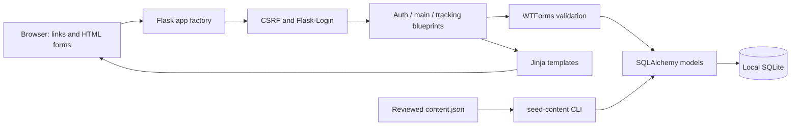

# Flask application architecture

The local application adds private parent planning to the existing public
guide. It is independent of Minerva and never connects to an applicant
account. The static Pages prototype remains in index.html and js/app.js;
the Flask app is in parenthub/. Native platform templates are unchanged.

## Components and request flow

The owner-requested UI redesign adds a public landing page at `/`, while
signed-in Home redirects to `/dashboard`. The route shows an invitation form
or a parent overview with one timeline per authorized synthetic applicant.
The current stage is the last milestone in the consecutive completed prefix,
and the next milestone is the first pending one. An empty journey and a
finished journey have distinct states. Personal checklist progress has no
effect on either value. The existing planning workspace moves to
`/planning`, and checklist, reminder, and question CRUD retain their routes.
Planning queries compose owned reminder and question
previews, personal progress, and the earliest incomplete parent preparation
item; no applicant action is recommended to a parent. The suggestion first
asks for an age group if none is saved. It is a transparent rule over saved
data, not an inference about Minerva's application status.

Flask's wider responsive layout and palette are generated from the `flask`
overrides in design-tokens.json using tools/flask_design_tokens.mjs. It
inherits semantic colors and leaves all inherited platform outputs intact.
This is the owner's web-only exception to the template-wide palette rule.
The original static guide is unchanged. The onboarding schema is additive
and uses the existing dependencies. Resource additions use the existing idempotent seed command.
Feedback uses flashed confirmations and small submit/offline handlers;
HTML forms and native details navigation work without JavaScript.

`create_app()` configures extensions, blueprints, error handling, and
security headers. Extension instances live in extensions.py, avoiding
circular initialization and allowing tests to create isolated apps.
auth.py handles registration and login; main.py handles public content and
the dashboard; tracking.py handles private checklist/reminder/question
work. forms.py validates data; models.py defines persistence. Templates
compose a shared base. CSS reuses the original palette, typography,
spacing, and parent-guide layout through two allowlisted asset routes.
The server serves no arbitrary repository files.

A reminder POST first passes CSRF protection and login, then validates the
form. Editing looks up both record ID and current user ID. If that pair
does not exist, the response is 404, even if another user owns that ID.
Only known form fields populate the record; user_id comes from the
session. A successful commit redirects to the list, so browser refresh
does not repeat the mutation. Validation failures render the entered
values with HTTP 422; database failures roll back and return HTTP 503.

An invitation carries a digest of a random code, a recipient email, and
an applicant ID. A signed-in parent explicitly accepts by submitting the
code. A conditional update binds a pending invitation to the current account
only if the email matches and the invitation is valid. Dashboard reads
require the accepted account ID and matching email. They recheck expiration
and revocation on each request. Application numbers are display identifiers.

The invitation row is the access grant. Its separate applicant and parent
references allow a future student-managed workflow to issue and revoke
individual grants. An eventual student issuer record can be added when
student identity is defined. This iteration exposes only the development CLI
for issuance and a parent form for acceptance.

Signed-in `/account` uses the existing CSRF-protected invitation endpoint.
`/application-progress` reuses the authorized journey projection. The
public `/financial-aid` page combines source-linked guidance with local
`aid_examples.json` disclosures. The old `/aid-preparation` URL redirects
for signed-in users. Document management requires the session's parent ID
and a currently authorized applicant. One row per parent, applicant, and
category stores a fixed sample ID and a share flag. Progress counts those
rows. An upsert links or replaces a sample and sets it private. The Open
action shows a local fictional preview. Only catalog choices are accepted,
and no real URL is taken as input or stored.

`seed-student` provisions a new password account and links it to one
fictional applicant in the same transaction. Registration and parent
invitations do not grant student access. The student view looks up the
applicant from the session account, and projects only explicitly shared
category names and the presence of a linked file. Each read also requires
the sharing parent's current email and a valid accepted invitation to that
applicant. Removing the share, expiring or revoking the invitation, or
removing the student link makes the row unavailable on the next request.
Replacing a file clears the share. Parent Hub sharing never changes Google
Drive permissions or exposes a file URL to the student.
Responses use the app's existing no-store policy. First-year details and
confidentiality procedures await specialist validation.

## Schema

Every table has an integer primary key named id. Foreign keys are enforced
on SQLite connections. Relationships are declared in models.py.

| Table | Main data | Relationships and constraints |
|---|---|---|
| user | email, password_hash, age_group | Unique email; allowed age groups or NULL; owns progress, reminders, questions |
| resource | slug, title, topic, description, url, last_verified | Unique stable slug; referenced by checklist items and deadlines |
| checklist_item | slug, title, responsibility, position, resource_id | Unique slug; resource FK; parent/applicant responsibility constraint |
| user_checklist_progress | user_id, item_id, completed | Two FKs; unique (user_id, item_id); absent row means incomplete |
| reminder | user_id, title, due_date, completed | User FK and owner index; personal dates only |
| parent_question | user_id, body, resolved | User FK and owner index; text remains private |
| official_deadline | slug, round_name, admissions, financial_aid, resource_id | Unique slug; resource FK; month/day text preserves unspecified year |
| synthetic_applicant | application_number | Unique fictional number with a SYN prefix |
| synthetic_milestone | applicant_id, position, title, completed | Synthetic applicant FK; unique position within each applicant |
| parent_invitation | applicant_id, invited_email, code_digest, expires_on, accepted_by_id, accepted_on, revoked_on | Synthetic applicant and user FKs; unique code digest; paired acceptance fields |
| synthetic_student | user_id, applicant_id | User primary key and unique synthetic applicant FK |
| aid_preparation | parent_id, applicant_id, category, status, location, shared | Legacy rows retained without conversion |
| aid_document | parent_id, applicant_id, category, sample, shared | Composite primary key and checked demo sample ID |
| synthetic_applicant_round | applicant_id, round_slug | Optional association with a published round for deadline prioritization |

Run `init-db` on an existing local database before starting this version.
It creates missing tables without altering existing columns, accounts, or
invitations. Legacy preparation statuses do not become linked files or
student shares. Existing milestone sequences remain readable.

## First-time financial aid preparation

First-time aid steps use the existing `checklist_item` and
`user_checklist_progress` tables. Run `seed-content` to add the reviewed
definitions by stable slug. Admissions progress queries exclude the
first-aid prefix. The public glossary and translation samples are local
content, and calculator inputs and the synthetic visibility preview stay
in the browser. See [international aid research](INTERNATIONAL-AID-RESEARCH.md).

## Exact deadlines and calendar downloads

The reviewed `exact_deadlines` catalog in `parenthub/content.json` is
independent of the published month/day round table. Each entry has a
unique cycle-specific `slug`, display `title`, timezone-aware ISO 8601
`at` timestamp, official Minerva `source`, and ISO `verified_on` date.
Round-specific entries also have a `round_slug` matching the published
round. Record a signed offset for the verified cutoff, including daylight
saving time where applicable. Parent Home prefers matching verified
events when an authorized applicant has a recorded round.

The official undergraduate tables reviewed for this redesign do not
provide exact year and cutoff details for their round dates. The catalog
therefore ships empty. Home links to published dates and official guidance.
Future verified entries enable clock-driven labels and RFC 5545 downloads.
Expired events disappear from the next request and calendar URLs return
404. Dates without a verified cutoff continue to appear by round only.

User-owned ORM collections cascade deletion of dependent records. Resources
are shared, rather than copied into every parent record. Checklist progress
is a many-to-many association with its own completed field. No child name,
date of birth, application status, applicant login, financial amount, or
document upload is collected.

## Decisions and tradeoffs

- **One server, SQLite, Jinja:** easy to run and explain, with transactional
  persistence and minimal JavaScript. SQLite suits a local interview demo;
  multiple high-volume writers or multiple server machines would need a
  different database and operational plan. The app factory follows the
  [Flask tutorial](https://flask.palletsprojects.com/en/stable/tutorial/factory/).
- **Composition:** blueprints compose the app, templates extend one base,
  forms share login validation, and User composes related records. There
  is no generic repository layer or custom authentication framework.
- **Explicit ownership:** Flask-Login identifies a user; it does not grant
  record permissions. The app must scope every private record query. See
  [Flask-Login's scope](https://flask-login.readthedocs.io/en/latest/).
- **CSRF on all mutations:** global Flask-WTF protection covers login,
  registration, logout, deletion, and updates. This follows the
  [Flask-WTF guidance](https://flask-wtf.readthedocs.io/en/1.2.x/csrf/).
- **Secure defaults for local use:** Werkzeug scrypt hashes, signed
  HttpOnly/SameSite cookies, eight-hour renewable sessions, no remember-me
  cookie, environment-provided secret, escaped Jinja output, parameterized
  queries, CSP and no-store responses. HTTPS deployments must enable
  SESSION_COOKIE_SECURE. No secret is generated into a tracked file.
- **Reviewed content:** seed-content upserts stable slugs from content.json,
  preserving IDs and user progress. It does not scrape on a page request.
  Last-verified dates describe manual checking, not guaranteed freshness.
  Checklist titles and guide prose reuse the prototype; parent tasks are
  preparation suggestions, not published Minerva duties.
- **Honest deadlines:** verified official month/day values are shown with
  a missing-year warning. No inferred intake, cutoff, application status,
  automatic calendar event, email, or background notification is created.
  A reminder's date is the parent's choice.
- **Small schema lifecycle:** init-db creates missing tables without
  dropping data. It is not a migration system and cannot alter existing
  columns. Future schema changes require explicit migrations; never delete
  a database containing real data to make a schema change work.
- **No private offline cache:** Flask pages do not load the prototype's
  compatibility scripts, manifest, or service worker. Optional JavaScript
  shows disconnection and disables POST buttons; core forms work without
  JavaScript. Browser back/forward display is not a server session or an
  authorization check; every server request rechecks access.

## Learning-orientation review

The owner's stated purpose is both parent planning and an interview-ready
engineering demonstration. The existing official family resources remain
the authority; the app adds personal progress and notes they do not hold
for this prototype. It touches parents, students whose autonomy matters,
and Admissions whose guidance must be represented accurately.

The strongest case against it is that a checklist could be mistaken for an
official application status or permission for parents to act as applicants.
The prototype keeps those boundaries visible and requires manual choices.
It deepens understanding through sources and separate responsibilities;
invites participation through parent-authored reminders and questions;
supports agency by sending nothing automatically; and favors readable
server-rendered forms over speculative automation. These are design
judgments, not evidence of parent usability testing.

## Verification and limits

Tests use temporary on-disk SQLite databases with CSRF enabled. They cover
the complete persisted account flow, password hashing, validation,
protected GET/POST routes, cross-account read/edit/delete denial, escaped
text, constraints, command idempotence, and database errors. An optional
headless Chrome harness starts its own isolated server and database under
ignored build/qa, drives forms, and captures responsive screenshots.

This is a local prototype. Password recovery, email verification, login
rate limiting, database migrations, backups, and a production WSGI/HTTPS
deployment are outside the requested scope. No claim of production
readiness, Minerva endorsement, or real-parent validation is made.
